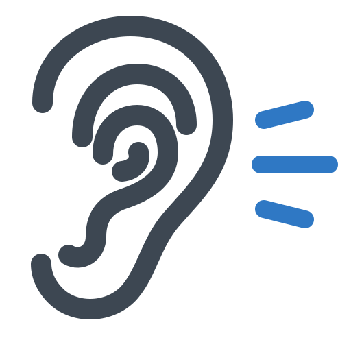

#  ovos-audio-transformer-plugin-autovolume

An [OpenVoiceOS](https://openvoiceos.org) audio transformer that speaks up
when the room is noisy and softly when it is quiet: louder over the
dishwasher and the kids, quieter at night.

It is part of [Emkay](https://github.com/emkay-voice/emkay) and works on any
OpenVoiceOS. To turn it on and off by voice there is
[ovos-skill-autovolume](https://github.com/emkay-voice/ovos-skill-autovolume).

[](https://github.com/emkay-voice/ovos-audio-transformer-plugin-autovolume/actions/workflows/publish.yml)
[](https://pypi.org/project/ovos-audio-transformer-plugin-autovolume/)

## Only loudness, nothing else

- While the listener waits for the wake word, OVOS hands the room audio to
  audio transformers. This one turns each bit of it into one number, how loud
  it was, and drops the audio. Nothing is recorded, kept or sent.
- What it keeps is a running level (over about 90 seconds), how quiet and how
  noisy the room tends to be, and the volumes you chose. That's a small JSON
  file in OVOS' data folder (`~/.local/share/mycroft/autovolume/autovolume.json`).
- It is off unless you turn it on (see [Setup](#setup)).

## It learns from you

There is nothing to tune. Out of the box the volume follows a soft curve from
a low volume (35 %) in the quietest moments of your room to a high one (75 %)
in the noisiest. It learns what quiet and noisy mean in *your* room from what
it hears, so no noise level has to be configured.

Then, every time you set the volume yourself ("louder", the volume slider,
Home Assistant), it remembers: *at this noise level, this is the volume I
want*. The curve goes through your choices:

- in between them it interpolates, and it always rises with the noise;
- newer choices count more than old ones, and a new one replaces an old one
  at about the same noise level, so it follows a new speaker or a new habit;
- until you have made a couple of choices, the defaults apply.

After you set the volume yourself it leaves it alone for 5 minutes. After
that, it moves the volume towards the curve again, from where you left it.

So you just correct it a few times, and after that it does what you would
have done.

## Gently, and hands off

- It looks at the volume every 5 seconds and moves it at most 2 points at a
  time, ignoring differences under 3 points, so it never pumps.
- It keeps its hands off, and stops measuring, while the device speaks,
  while it listens to you, while something plays (music, radio, a story) and
  while it is muted, and for a few seconds after. It would otherwise hear
  itself and turn itself up.
- **Speech only** (the default): music and stories have their own volume.
  When something starts playing, the volume goes back to the one you last set
  yourself; when it stops, auto volume takes over again. With
  `"speech_only": false` media plays at the room's volume too.

The volume is set with OVOS' own messages (`mycroft.volume.set`, without the
blop sound), so whatever handles volume on the device does the rest: a PHAL
plugin such as ovos-PHAL-plugin-alsa on a Pi, the browser in Emkay. There is
no audio system code in the plugin.

## Setup

```bash
pip install ovos-audio-transformer-plugin-autovolume
```

Name it in `mycroft.conf` (that is the opt-in):

```json
{
  "audio_transformers": {
    "ovos-audio-transformer-plugin-autovolume": {
      "speech_only": true,
      "low": 0.35,
      "high": 0.75
    }
  }
}
```

`"active": false` in the same place turns it off again.

| key | default | |
|---|---|---|
| `enabled` | `true` | start right away; turning it on or off on the bus is remembered |
| `speech_only` | `true` | media goes back to the volume you last set yourself |
| `low` / `high` | `0.35` / `0.75` | volumes for the quiet and the noisy end of the room, until you have taught it |
| `window_seconds` | `90` | the room's running level is over about this long |
| `step_seconds` | `5` | how often it looks at the volume |
| `max_step` | `0.02` | the most it moves the volume per step |
| `deadband` | `0.03` | smaller differences are left alone |
| `hold_seconds` | `300` | after you set the volume, it is left alone this long |
| `tail_seconds` | `3` | it waits this long after speech or playback |
| `min_points` | `2` | how many of your own settings before they shape the curve |

## On the bus

| message | |
|---|---|
| `ovos.autovolume.enable` / `.disable` | turn it on and off (remembered) |
| `ovos.autovolume.forget` | forget what it has learned: your volumes and the room |
| `ovos.autovolume.status` | how it stands |

Each answers with `<message>.response`:

```json
{"enabled": true, "speech_only": true, "points": 4, "learning": true,
 "level_db": -47.3, "quiet_db": -61.5, "noisy_db": -38.5,
 "target": 0.48, "volume": 0.47, "paused": false}
```

## Emkay

In Emkay the browser owns the microphone and Emkay's listener does what
ovos-dinkum-listener does. It does not feed audio transformers yet; that is
[emkay#105](https://github.com/emkay-voice/emkay/issues/105), and this plugin
waits for it there, like
[overheard manners](https://github.com/emkay-voice/ovos-audio-transformer-plugin-overheard-manners).
Emkay already takes the microphone without automatic gain control, so the
level means something.

## History

The idea comes from my old Mycroft skill,
[auto-volume-skill](https://github.com/andlo/auto-volume-skill) (2018), which
read the listener's mic level and set the mixer to high, normal or low. This
is new code under Apache-2.0; only the idea carries over.

## License

Apache-2.0
